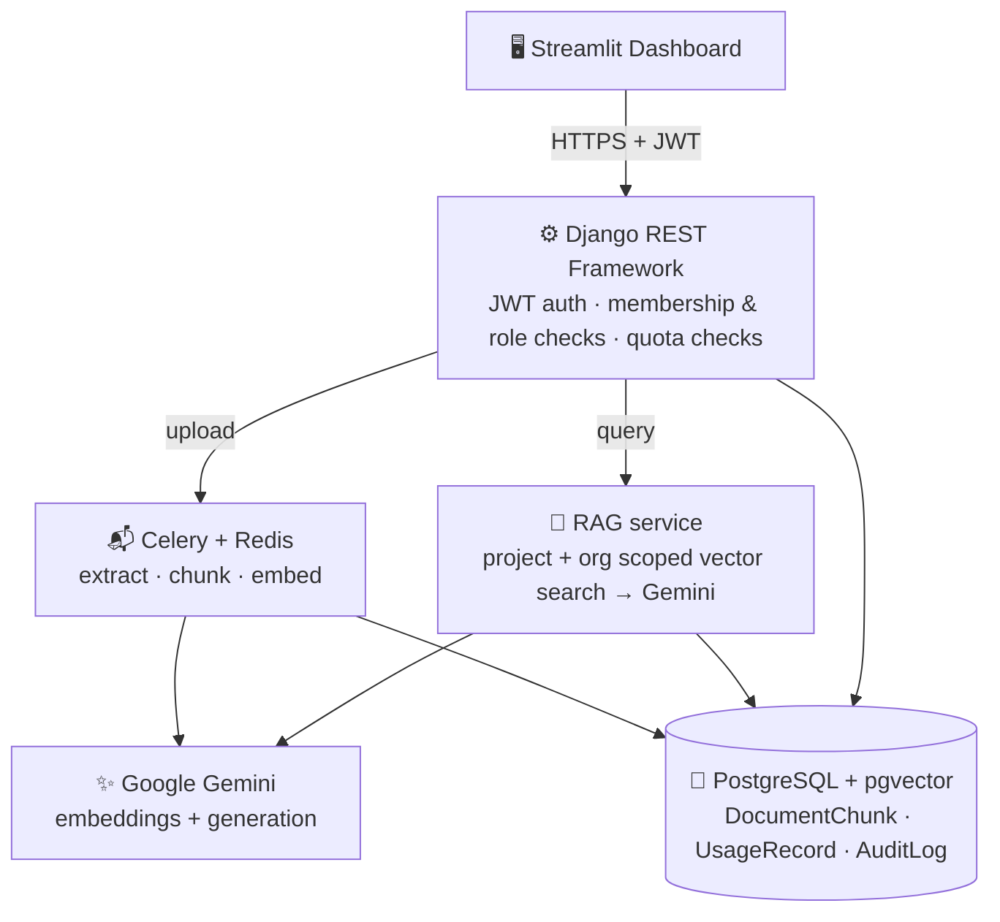
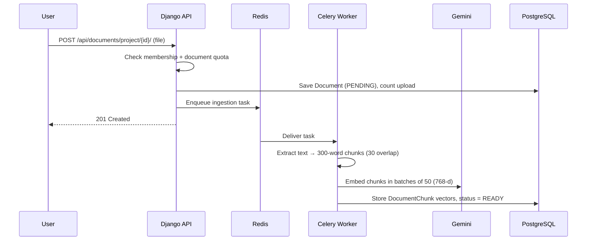

<div align="center">

# 🧠 Multi-Tenant Enterprise AI Knowledge Engine

### A RAG SaaS backend with tenant-scoped retrieval, async ingestion and plan-based usage limits

[](https://www.djangoproject.com/)
[](https://www.django-rest-framework.org/)
[](https://github.com/pgvector/pgvector)
[](https://ai.google.dev/)
[](https://docs.celeryq.dev/)
[](https://redis.io/)
[](https://streamlit.io/)
[](https://www.docker.com/)

[**🚀 Live Demo**](https://multi-tenant-rag-engine.streamlit.app) ·
[**📚 API Docs (Swagger)**](https://multi-tenant-rag-engine.onrender.com/api/docs/) ·
[**🛠️ Admin Portal**](https://multi-tenant-rag-engine.onrender.com/admin/)

</div>

---

## 📖 Overview

Teams want AI search over their private documents, but they cannot risk **one customer's data appearing in another's answers**, and they need to **cap LLM spend per customer**.

This project is a multi-tenant **Retrieval-Augmented Generation (RAG)** platform built around those two concerns. Users register, create an organization, group documents into projects and chat with their own knowledge base. Every answer comes back with the source chunks it was grounded in.

| Concern | How it is handled |
| :-- | :-- |
| 🔒 **Tenant isolation** | Data is modelled as `Organization → Project → Document → DocumentChunk`. The query endpoint verifies the caller's membership, then vector search runs only on chunks matching **both** the project and its organization. A project with no indexed chunks returns an empty result, never another tenant's data. |
| ⚡ **Non-blocking ingestion** | Uploads return `201 Created` immediately. Parsing, chunking and embedding run in Celery workers, with a visible `PENDING → PROCESSING → READY / FAILED` status. |
| 💳 **Plan limits** | Each organization has a plan with monthly limits on AI requests, tokens and documents. A request is **reserved atomically before** the model is called (row lock + `F()` update), tokens are added from Gemini's usage metadata afterwards, and failed provider calls are released, not charged. Exhausted limits return `429`. |
| 🧾 **Audit trail** | Document uploads, project creation and AI queries (metadata only, never the question text) are recorded per organization and exposed to Owners and Admins only. |

---

## ✨ Features

- 🏢 **Organizations, projects and roles** – `OWNER` / `ADMIN` / `MEMBER` memberships; invitations, role changes, plan changes, audit logs and deleting projects or documents are restricted to elevated roles
- 📄 **Document ingestion** – PDF, TXT and DOCX, parsed and split into overlapping 300-word chunks (30-word overlap)
- 🔍 **Semantic search** – 768-dimensional Gemini embeddings (`gemini-embedding-001`) stored in PostgreSQL with `pgvector` and an HNSW index, ranked by cosine distance
- 💬 **Multi-turn, grounded chat** – a Gemini model answers only from the retrieved context, uses the last 10 chat turns, and returns the cited chunks
- 📊 **Usage metering** – per-organization monthly request, token (from Gemini usage metadata) and document counters, reserved before each call
- 🚦 **Honest failures** – provider errors surface as `502` and failed ingestion marks the document `FAILED`; the system never indexes placeholder vectors or returns made-up answers
- 📋 **Audit log API** – Owner/Admin-only list of organization events
- 🔐 **JWT authentication** – SimpleJWT access/refresh tokens with refresh-token blacklisting
- 💳 **Subscription plans** – FREE / PRO / BUSINESS tiers (plan change is a simulated upgrade; no payment integration)
- 📘 **OpenAPI 3.0 docs** – generated with `drf-spectacular`
- 🖥️ **Streamlit dashboard** – register/login, workspace and project switcher, document upload, chat with sources, usage metrics, invitations
- 🛡️ **Production settings** – separate `production.py` with `DEBUG=False`, explicit CORS origins, HTTPS redirect and HSTS

---

## 🏗️ Architecture



### 📥 Ingestion flow



### 💬 Query flow

```mermaid
sequenceDiagram
    participant U as User
    participant A as Django API
    participant D as PostgreSQL
    participant G as Gemini

    U->>A: POST /api/ai/query/ (project_id, query, top_k, chat_history)
    A->>D: Verify membership in the project's organization
    A->>D: Reserve one request (row-locked; 429 if limit reached)
    A->>D: Cosine search on chunks WHERE project AND organization match
    A->>G: Retrieved context + chat history + question
    G-->>A: Answer + token usage
    A->>D: Add tokens used (or release the reservation on failure)
    A->>D: Write audit entry
    A-->>U: response, sources, tokens_consumed (502 if the provider failed)
```

---

## 🛠️ Tech Stack

| Layer | Technology | Purpose |
| :-- | :-- | :-- |
| **API** | Django 5.1, Django REST Framework | Business logic, role checks, REST endpoints |
| **Auth** | SimpleJWT (+ token blacklist) | Stateless bearer tokens, refresh rotation |
| **Database** | PostgreSQL 16 + `pgvector` | Relational data and vector similarity in one store |
| **AI** | Google Gemini via `google-genai` | 768-d embeddings (`gemini-embedding-001`) and answer generation |
| **Async jobs** | Celery 5.4+, Redis 7 | Background document processing |
| **Parsing** | `pypdf`, `python-docx` | PDF and DOCX text extraction |
| **Frontend** | Streamlit | Interactive dashboard |
| **API docs** | `drf-spectacular` | OpenAPI schema and Swagger UI |
| **Serving** | Gunicorn, Docker | Production container |
| **Testing** | `pytest`, `pytest-django` | Automated tests |

---

## 📂 Project Structure

```text
multi-tenant-rag-engine/
├── apps/
│   ├── accounts/         # Custom user model, register/login/refresh
│   ├── ai/               # Query endpoint + RAG service (retrieval, Gemini, error handling)
│   ├── audit/            # Audit log model, signals and list API
│   ├── common/           # Throttling and exception handling
│   ├── documents/        # Models, parsing, chunk vectors, Celery task, `reembed_documents` command
│   ├── organizations/    # Organizations, memberships, invitations
│   ├── projects/         # Projects (scoped containers for documents)
│   ├── subscriptions/    # Plans, subscription, `seed_plans` command
│   └── usage/            # Monthly usage counters and limits
├── config/               # Settings (base / development / production), Celery
├── scripts/              # Helper scripts
├── tests/                # Pytest suite
├── frontend_app.py       # Streamlit dashboard
├── docker-compose.yml    # PostgreSQL (pgvector) + Redis for local development
├── Dockerfile            # Gunicorn image for the API
├── manage.py
├── pytest.ini
├── requirements.txt
└── .env.example
```

---

## ⚡ Getting Started

### Prerequisites

- Python **3.11+**
- Docker (for PostgreSQL with `pgvector` and Redis)
- A [Google Gemini API key](https://aistudio.google.com/app/apikey)

### 1. Clone and install

```bash
git clone https://github.com/ShashankSingh2020/multi-tenant-rag-engine.git
cd multi-tenant-rag-engine

python -m venv venv
source venv/bin/activate        # Windows: venv\Scripts\activate
pip install -r requirements.txt
```

### 2. Start PostgreSQL (pgvector) and Redis

```bash
docker compose up -d
```

PostgreSQL runs on `5432` (database `multi_tenant_ai_saas`, user and password `postgres`) and Redis on `6379`.

### 3. Configure environment

```bash
cp .env.example .env      # then set DJANGO_SECRET_KEY and GEMINI_API_KEY
```

The defaults already match `docker-compose.yml`. The AI-related variables are:

```env
GEMINI_API_KEY=your-gemini-api-key
GEMINI_MODEL=gemini-3.8-flash          # generation model
EMBEDDING_MODEL=gemini-embedding-001   # embedding model
EMBEDDING_DIMENSIONS=768               # must match the pgvector column
```

> Check [Google's deprecation schedule](https://ai.google.dev/gemini-api/docs/deprecations) before choosing models; for example `text-embedding-004` was shut down in January 2026. **If you change `EMBEDDING_MODEL`, run `python manage.py reembed_documents`** — vectors from different models are not comparable.

> Never commit `.env` or share it in archives. Rotate any key that has been exposed.

### 4. Migrate, seed plans, create an admin

```bash
python manage.py migrate
python manage.py seed_plans        # creates the FREE / PRO / BUSINESS plans
python manage.py createsuperuser
```

### 5. Run the three services

Use three terminals with the virtual environment active:

```bash
# Terminal 1: API
python manage.py runserver 8000

# Terminal 2: background worker
celery -A config worker --loglevel=info          # add  -P solo  on Windows

# Terminal 3: dashboard
API_BASE_URL=http://localhost:8000/api streamlit run frontend_app.py
```

> **Windows PowerShell:** `$env:API_BASE_URL="http://localhost:8000/api"; streamlit run frontend_app.py`

Open **http://localhost:8501**, register, create an organization and a project, upload a document and ask questions once its status is `READY`.

### 6. Run the tests

```bash
pytest
```

The suite (44 tests) runs on in-memory SQLite with Celery in eager mode and mocked Gemini calls, so it needs no external services (copy `.env.example` to `.env` first so `DJANGO_SECRET_KEY` is set). SQLite cannot run pgvector operators, so vector *ranking* is not covered by the unit tests; it was verified manually against PostgreSQL 16 + pgvector (see Roadmap for the CI job).

---

## 🚢 Production Deployment

The container runs Gunicorn with `config.settings.production` (the default for `wsgi.py` / `asgi.py`).

```bash
docker build -t rag-engine .
docker run -p 8000:8000 --env-file .env rag-engine
```

Run a Celery worker from the same image (`celery -A config worker`) alongside the API.

| Variable | Purpose |
| :-- | :-- |
| `DJANGO_SECRET_KEY` | Required secret key |
| `DATABASE_URL` | PostgreSQL with the `pgvector` extension |
| `CELERY_BROKER_URL` / `CELERY_RESULT_BACKEND` | Redis URLs for Celery |
| `GEMINI_API_KEY` | Gemini credentials |
| `DJANGO_ALLOWED_HOSTS` | Comma-separated hosts |
| `CORS_ALLOWED_ORIGINS` | Comma-separated dashboard origins |
| `GEMINI_MODEL` / `EMBEDDING_MODEL` / `EMBEDDING_DIMENSIONS` | Model selection (see `.env.example`) |
| `SECURE_SSL_REDIRECT` | Set to `False` behind a proxy that already terminates TLS |

> Uploaded files are stored on the local filesystem. For multi-instance deployments, share `MEDIA_ROOT` between the API and worker or move to object storage.

---

## 🔌 API at a Glance

Interactive documentation: **`/api/docs/`**.

| Method | Endpoint | Description |
| :-- | :-- | :-- |
| `POST` | `/api/auth/register/` | Register (`email`, `full_name`, `password`, `password_confirm`) |
| `POST` | `/api/auth/login/` | Obtain JWT access + refresh tokens |
| `POST` | `/api/auth/refresh/` | Refresh the access token |
| `GET` | `/api/auth/me/` | Current user |
| `GET` `POST` | `/api/organizations/` | List / create organizations |
| `GET` `POST` | `/api/organizations/{id}/members/` | List / add members |
| `PATCH` `DELETE` | `/api/organizations/{id}/members/{member_id}/` | Change role / remove member |
| `POST` | `/api/organizations/{id}/invites/` | Create an invitation |
| `POST` | `/api/organizations/invites/accept/` | Accept an invitation |
| `GET` `POST` | `/api/projects/?organization={id}` | List / create projects |
| `GET` `POST` | `/api/documents/project/{project_id}/` | List / upload documents (async ingestion) |
| `POST` | `/api/ai/query/` | RAG query |
| `GET` | `/api/usage/summary/?organization={id}` | Plan limits and monthly consumption |
| `GET` | `/api/audit/?org_id={id}` | Audit log (Owner/Admin) |
| `GET` | `/api/subscriptions/plans/` | Available plans |
| `GET` `POST` | `/api/subscriptions/current/` · `/change/` | Current plan / change plan (Owner) |

**Example query**

```bash
curl -X POST http://localhost:8000/api/ai/query/ \
  -H "Authorization: Bearer <ACCESS_TOKEN>" \
  -H "Content-Type: application/json" \
  -d '{
        "project_id": "<PROJECT_UUID>",
        "query": "What are the main termination clauses?",
        "top_k": 3,
        "chat_history": []
      }'
```

```json
{
  "response": "…answer grounded in your documents…",
  "sources": ["Contract.pdf (Chunk #4)", "Contract.pdf (Chunk #5)"],
  "tokens_consumed": 812
}
```

Quota exhaustion returns `429 Too Many Requests`; an unavailable AI provider returns `502 Bad Gateway` and the request is not charged.

---

## 🛡️ Security Design

- **Tenant-scoped retrieval** – membership is verified first; vector search then filters on project *and* organization before ranking.
- **Role checks** – member management, invitations, plan changes, deletions and the audit log are limited to elevated roles; members cannot grant themselves higher roles.
- **Concurrency-safe quotas** – requests are reserved under a row lock before the model call, so parallel requests cannot overshoot a plan.
- **Prompt-injection hygiene** – retrieved text is passed as delimited data and the model is told never to follow instructions inside it; chat history is capped in size.
- **Hardened production profile** – no `DEBUG`, explicit CORS origins, secure cookies, HSTS and HTTPS redirect.
- **Secrets via environment** – nothing sensitive in source; `.env` is git-ignored.

---

## 🗺️ Roadmap

- [ ] Audit member changes and plan changes
- [ ] Streaming chat responses
- [ ] Member list and role editor in the dashboard
- [ ] Hybrid search (keyword + vector) with re-ranking
- [ ] Postgres + pgvector test job in CI (GitHub Actions)
- [ ] Object storage for uploaded files

---

## 🤝 Contributing

Issues and pull requests are welcome. Please run `pytest` before opening a PR.

---

## 👤 Author

**Shashank Pratap Singh**
[GitHub](https://github.com/ShashankSingh2020) · [LinkedIn](https://linkedin.com/in/shashank-pratap-singh-530437303) · singh2020shashank@gmail.com

<div align="center">

⭐ If this project helped you, consider giving it a star!

</div>

<!--
TODO (optional, big visual upgrade): add screenshots under docs/screenshots/ and embed them here, e.g.


-->
